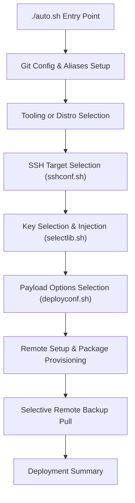
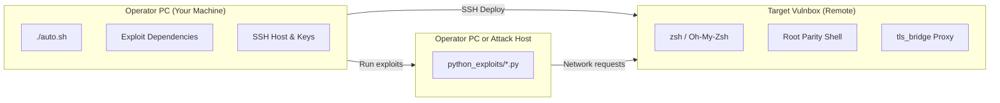

<!-- SPDX-License-Identifier: AGPL-3.0-or-later -->
<!-- Purpose: Attack/Defense CTF remote deployment toolkit, operator shell environment, and Python exploit collection. -->

# Vulnbox-AutoConfig

[](VERSION.json)
[](LICENSE)
[](https://github.com/ctterrlt/Vulnbox-autoconfig/actions/workflows/ci.yaml)
[](#requirements)
[](#installation)

**Vulnbox-AutoConfig** is a deployment toolkit and exploit collection for authorized **Attack/Defense CTF competitions**. It covers two parts of that workflow:

1. **🛠 Vulnbox Setup & Remote Hardening** — Transforms a fresh, minimal, or reset remote shell into a fully configured, hardened operator environment (zsh, Oh-My-Zsh, robust plugins, security aliases, modern editor setups, and root shell parity) with a single command over SSH.
2. **💉 Exploit Arsenal & Automation** — A collection of modular Attack/Defense exploits, configuration helpers, and defensive traffic inspection tools.

---

## Status

The repository contains deployment workflows for Arch Linux, Debian/Ubuntu, and Fedora, plus a modular Python exploit collection and a defensive TLS bridge. CI workflow files provide syntax, dependency-sync, and lint checks; the current state of those checks is shown by the CI badge above.

- **Unified Entry Point:** The master orchestrator [`auto.sh`](auto.sh) handles host aliasing, SSH key distribution, distro deployment, optional Pwnzer0tt1 tools, and local dependency management.
- **Automated Root Parity:** The opt-in [`root_shell.sh`](root_shell.sh) mirrors Zsh and Bash aliases and selected dotfiles into `/root`; it also copies configured SSH identity files so root can use the same SSH hosts.
- **Dependency Automation:** Exploit requirements across all subprojects are aggregated automatically into the repo-root [`requirements.txt`](requirements.txt) and [`pyproject.toml`](pyproject.toml) via [`scripts/gen_requirements.py`](scripts/gen_requirements.py) and staged on commit via [`.githooks/pre-commit`](.githooks/pre-commit). Unpinned entries resolve to the latest release; pinned specs are honored. [`uv.lock`](uv.lock) provides a reproducible resolution for `uv sync`.
- **Execution Guard:** The master [`auto.sh`](auto.sh) stops in detected containers. Direct distro scripts warn and require confirmation before proceeding.

---

## Capabilities

### Remote Provisioning & Environment Setup
- **Zero-Touch SSH Management:** Interactive target specification or automated reuse of existing `~/.ssh/config` hosts via `ssh -G`. Automatically generates missing ed25519 keypairs, displays fingerprints, and writes persistent configuration aliases.
- **Resilient Key Deployment:** Employs literal single-quoted in-stream key injection with remote duplicate checking. Avoids `base64` decode dependencies that fail silently on stripped systems (e.g., antiX, busybox) and bypasses OpenSSH 10.x `ssh-copy-id` standalone public key quirks.
- **Granular Key & Alias Selection:** Sourced by [`selectlib.sh`](selectlib.sh), offering multi-select toggle, range selection, and batch confirmation for deployed public keys (`id_ed25519.pub` and optional teammate keys in the local `extra_keys.pub`, seeded empty from [`extra_keys.pub.example`](extra_keys.pub.example)) and Git aliases.
- **Cross-Distro Packaging:** Automated package installation across **Arch Linux** (`pacman`), **Debian/Ubuntu** (`apt`), and **Fedora** (`dnf` with `--skip-unavailable`). Installs core runtimes (including `php` for web exploit helpers) plus best-effort cosmetic tools (`fastfetch`, `lsd`, `tty-clock`, `cmatrix`).
- **Defensive & Diagnostic Aliases:** Out-of-the-box aliases for rapid triage: network listening (`ss`), sniffing (`tcpdump`), container inspection (`docker ps`, `docker compose logs`), package management (`pip`, `uv`), and security service control.
- **Minimal Distro Support (antiX, Alpine, Minimal VMs):** The deployed `.zshrc` dynamically prepends `/usr/local/sbin`, `/usr/sbin`, and `/sbin` to `$PATH`, ensuring administrative utilities (`ip`, `ss`, `iptables`, `fdisk`) function seamlessly when sbin is excluded from default user paths.
- **Root Shell Parity:** The opt-in target setup sets zsh as root’s login shell, provisions Oh-My-Zsh, shares Zsh and Bash aliases, and copies selected SSH identity files.
- **Shell Reload Shortcuts:** Bare `zsh` and `bash` reload their respective config files; adding arguments runs the normal shell command, including commands combined with shell operators. Each distro's Bash aliases are installed as `~/.bashrc_vulnbox` and sourced from an existing regular `~/.bashrc`.
- **Bash Alias Support:** The `sshrc` helper safely clears a conflicting alias, prefers `99-custom-ssh.conf`, and falls back to the deployed `00-custom-ssh.conf`.
- **Selective Remote Backups:** Inspects the remote home directory over SSH, allows selective directory archiving (home-relative, tilde, or absolute paths), downloads `backup_from_<IP>.zip` without overwriting (adding a numeric suffix if needed), and optionally initializes local Git repositories with sane `.gitignore` rules.

### Exploit Arsenal & Automation
- **Fast uv Dependency Management:** The local dependency prompt prefers `uv` over pip. Install into `~/.local` to keep packages covered by the `uvtotal` shell shortcut, or use the generated `pyproject.toml` + `uv.lock` with `uv sync` for a reproducible `.venv`. Packages without a version spec install the latest release; explicit pins are respected.
- **Modular Exploit Projects:** Service-specific attack logic is separated from target settings, with configuration helpers for interactive or environment-based setup.
- **Decoupled Target Configuration:** Every exploit isolates target specifics (ports, credentials, injection vectors, formats) in a dedicated `module_<project>.py`, configurable interactively via `auto_<project>.sh` or programmatically via `.env`.
- **Defensive Traffic Decryption (`tls/`):** Long-running defensive TLS termination and inspection bridge that intercepts inbound HTTPS traffic to your vulnbox service, exposes plaintext streams for real-time traffic analysis, and transparently re-encrypts upstream connections.
- **Pwnzer0tt1 Tooling Orchestrator:** Optional management for `digger` and `firegex`, with branch selection (`main` vs `dev`), merge/rebase conflict handling, and non-blocking subshell builds.

---

## Requirements

| Component | Target / Environment | Prerequisites | Privileges |
| :--- | :--- | :--- | :--- |
| **Deploy Orchestrator** | Local Operator Machine | Linux / macOS / BSD, Bash 4+, OpenSSH client, Python 3 | Regular user (`sudo` used on target only) |
| **Arch Targets** | Remote Vulnbox / VM | Arch Linux, network connectivity, SSH access | Sudo / root access |
| **Debian / Ubuntu Targets** | Remote Vulnbox / VM | Debian 10+ / Ubuntu 20.04+, SSH access | Sudo / root access |
| **Fedora Targets** | Remote Vulnbox / VM | Fedora 38+, SSH access | Sudo / root access |
| **Exploit Arsenal** | Operator PC / Attack Box | Python 3.10+, pip / uv, optional PHP CLI | Regular user |
| **TLS Defense Bridge** | Remote Vulnbox | Python 3 standard library (`asyncio`, `ssl`) | Service user / root (if binding < 1024) |

### Compatibility Notes

- **Container Safety Guard:** The master script stops in detected container environments. Direct distro deployment scripts display a warning and ask whether to continue.
- **SCP Protocol Compatibility:** Prompts for legacy SCP (`-O`) or modern SFTP transport. Legacy `-O` ensures seamless file transfers on remote hosts lacking SFTP subsystems.
- **Python Package Isolation:** Exploit dependencies support `uv` user-site installs (`~/.local`, also covered by `uvtotal`), locked project virtual environments (`uv sync`), pip `--break-system-packages`, user prefixes, and local virtual environments. Unpinned requirements resolve to the latest release; version specifiers are honored.

---

## Installation

### 1. Master Deployment (Recommended)

Execute the master deployment center from the repository root:

```bash
chmod +x auto.sh
./auto.sh
```

The orchestrator guides you through:
1. Importing or refreshing Git configuration and aliases into your local `~/.gitconfig`.
2. Selecting target distribution (**Arch**, **Debian/Ubuntu**, **Fedora**) or installing/updating **Pwnzer0tt1 tools** (`digger` and `firegex`).
3. Configuring SSH connectivity, host aliases, and public key deployment.
4. Selecting payloads to deploy (Neovim, Git aliases, nano, Konsole, TLS bridge, root shell setup, dev repository clone).
5. Executing remote provisioning and package installation, optionally pulling a selected backup, and printing a deployment summary. Connect to the target separately with its configured SSH alias.

### 2. Standalone Per-Distro Deployment

To bypass the master menu and deploy directly to a specific target distribution:

```bash
# Arch Linux
cd arch && ./arch_auto.sh

# Debian / Ubuntu
cd debian_ubuntu && ./debian_ubuntu_auto.sh

# Fedora
cd fedora && ./fedora_auto.sh
```

> [!TIP]
> If your SSH public key is already present in the target's `authorized_keys`, set `SKIP_SSH=1` to skip key generation and copying:
> ```bash
> SKIP_SSH=1 ./auto.sh
> ```

### 3. Re-Pushing Configuration Only

If you have modified shell aliases, themes, or environment variables and only want to refresh the configuration on a running box without reinstalling packages:

```bash
# Arch Linux
./arch/zshchangeconf_arch.sh

# Debian / Ubuntu
./debian_ubuntu/zshchangeconf_debian_ubuntu.sh

# Fedora
./fedora/zshchangeconf_fedora.sh
```

### 4. Standalone Host Installation (Local / Manual)

To configure the current host directly without SSH:

```bash
./arch/zshinstall_arch.sh             # On Arch
./debian_ubuntu/zshinstall_debian_ubuntu.sh # On Debian/Ubuntu
./fedora/zshinstall_fedora.sh         # On Fedora
```

---

## Usage

When launching `./auto.sh`, the interactive deployment pipeline executes the following stages in sequence:



1. **Git Configuration Setup:** Prompts whether to import the shared aliases (`gitconfig.conf`) into your local `~/.gitconfig` (all at once via `include.path` or item-by-item via `selectlib.sh`).
2. **Git Clone Protocol:** Sets preference for `https` or `ssh` (git@) when cloning tools or dev repositories.
3. **SSH Target Configuration (`sshconf.sh`):**
   - Offers to reuse an existing host from `~/.ssh/config` (resolved via `ssh -G` to prefill IP, user, and port).
   - Alternatively, prompts for target IP, username, port (default: 22), and a custom host alias, creating an entry in `~/.ssh/config`.
4. **Transport Mode:** Chooses between legacy SCP (`-O`, default) and modern SFTP.
5. **Key Deployment:** Interactive selector for `id_ed25519.pub` and optional team keys from the local, gitignored `extra_keys.pub` (created empty from `extra_keys.pub.example` on first run; add intended public keys locally). Selected keys are added to `~/.ssh/authorized_keys` with SSH directory and file permissions set to `0700` and `0600`.
6. **Payload Options (`deployconf.sh`):**
   - **Local Python deps:** Option to install/update root `requirements.txt` on the operator PC. When `uv` is available it is used instead of pip: choose the `~/.local` user site (fast, also maintained by `uvtotal`) or a reproducible project `.venv` from `pyproject.toml` + `uv.lock` (`uv sync`).
   - **Neovim (`nvimconfig.lua`):** Provisions `~/.config/nvim/init.lua` and ensures `neovim` is installed.
   - **Git Aliases (`gitconfig.conf`):** Provisions `~/.gitconfig_vulnbox` on the target and links it via `include.path`.
   - **TLS Bridge:** Ships `python_exploits/tls` to `~/tls_bridge` on the target.
   - **nano Config (`nanorc`):** Drops `~/.nanorc` with syntax highlighting and sane indentation.
   - **Konsole Config (`konsolerc` + profile):** Provisions GUI terminal settings with live shortcut sync.
   - **SSH Hardening (`sshd_00-custom-ssh.conf`):** Validates and installs `/etc/ssh/sshd_config.d/00-custom-ssh.conf`, retains the active connection port alongside 22222, and disables password and root login. Opt in only after confirming key-based access.
   - **nftables Firewall (`nftables.conf`):** Adds a dedicated table to the config loaded by the target’s nftables service (`/etc/nftables.conf` on Arch and Debian/Ubuntu; `/etc/sysconfig/nftables.conf` on Fedora). It uses default input drop and VPN interface allowlisting (`wt0`, `tailscale0`, `100.64.0.0/10`), so it can block this connection and other inbound services.
   - **Fail2ban (`fail2ban_jail.local`):** Validates and installs `/etc/fail2ban/jail.local` using the systemd backend, protects SSH on port 22222 plus the active target port, and sets a one-hour ban time.
   - **sysctl Hardening (`sysctl_90-no-ping.conf`):** Drops `/etc/sysctl.d/90-no-ping.conf` (`net.ipv4.icmp_echo_ignore_all = 1`) to suppress ping responses.
   - **Target Root Shell (`root_shell.sh`):** Configures `/root` to mirror user Zsh, Bash aliases, selected dotfiles, and SSH identities (default: yes).
   - **Dev Repo Clone:** Clones this toolkit directly onto the vulnbox via HTTPS for on-box debugging.
7. **Remote Setup Execution:** Ships packages and payload scripts to `/tmp`, establishes a pseudo-TTY SSH session, installs packages with `pacman`, `apt`, or `dnf`, and applies selected configs.
8. **Remote Backup & Recovery:** Prompts whether to pull a backup, lists the remote home directory (`lsd` or `ls -lah`), prompts for specific directories, downloads to `<dest>/backup_from_<IP>.zip` without overwriting an existing file, and optionally extracts and initializes local Git tracking.
9. **Deployment Summary:** Prints the target, enabled features, and a next-steps checklist. The deploy script exits after the summary; connect separately with `ssh <host-alias>`.

---

## Architecture

```text
.
├── auto.sh                          # Master entry point: Git setup, distro menu, optional tool installs
├── sshconf.sh                       # SSH target resolution, keygen, alias management, key injection
├── deployconf.sh                    # Shared deployment options, backup handling, deployment summary
├── root_shell.sh                    # Root parity orchestrator (mirrors user dotfiles and shell to /root)
├── apply_hardening.sh                # Validates, applies, and rolls back selected target hardening
├── install_bash_config.sh            # Adds Bash aliases without replacing an existing .bashrc
├── selectlib.sh                     # Interactive item selector (toggle, add, remove, batch confirm)
├── gitconfig.conf                   # Shared Git aliases and configuration
├── nvimconfig.lua                   # Shared Neovim configuration (init.lua)
├── nanorc                           # Shared nano editor configuration
├── konsolerc                        # Shared Konsole baseline shortcuts and UI settings
├── konsole.profile                  # Shared Konsole profile configuration
├── sshd_00-custom-ssh.conf          # Hardened OpenSSH daemon drop-in config (port 22222, key-only)
├── nftables.conf                    # Stateful firewall ruleset (VPN interface & subnet allowlist)
├── fail2ban_jail.local              # Fail2ban jail configuration (systemd backend, port 22222)
├── sysctl_90-no-ping.conf           # Kernel sysctl hardening (disables ICMP echo response)
├── extra_keys.pub.example           # Empty, comment-only template for local teammate public keys
├── VERSION.json                     # Stable release target (1.0.0), source for the README version badge
├── CHANGELOG.md                     # Version history and unreleased changes
├── requirements.txt                 # Auto-aggregated pip-compatible dependency view
├── pyproject.toml                   # Auto-generated PEP 621 manifest for uv/pip
├── uv.lock                          # Committed uv resolution (uv sync / uv lock --upgrade)
│
├── scripts/
│   └── gen_requirements.py         # Aggregates requirements into root manifests + optional lock
├── .githooks/
│   └── pre-commit                   # Git hook keeping requirements.txt + pyproject.toml in sync
├── .github/workflows/
│   ├── ci.yaml                      # Syntax, dependency-sync, and lint jobs
│   └── release.yaml                 # Tag-based archive and GitHub Release workflow
│
├── arch/                            # Arch Linux deployment suite
│   ├── arch_auto.sh                 # Full remote automated deploy
│   ├── zshconfig_arch.conf          # Arch-specific zsh configuration
│   ├── bashconfig_arch.conf         # Arch-specific Bash aliases derived from Zsh
│   ├── zshchangeconf_arch.sh        # Configuration re-push script
│   ├── zshinstall_arch.sh           # Local standalone installer
│   └── README.md                    # Arch-specific documentation
│
├── debian_ubuntu/                   # Debian & Ubuntu deployment suite
│   ├── debian_ubuntu_auto.sh        # Full remote automated deploy
│   ├── zshconfig_debian_ubuntu.conf # Debian/Ubuntu-specific zsh configuration
│   ├── bashconfig_debian_ubuntu.conf # Debian/Ubuntu Bash aliases derived from Zsh
│   ├── zshchangeconf_debian_ubuntu.sh # Configuration re-push script
│   ├── zshinstall_debian_ubuntu.sh  # Local standalone installer
│   └── README.md                    # Debian/Ubuntu-specific documentation
│
├── fedora/                          # Fedora deployment suite
│   ├── fedora_auto.sh               # Full remote automated deploy
│   ├── zshconfig_fedora.conf        # Fedora-specific zsh configuration
│   ├── bashconfig_fedora.conf        # Fedora Bash aliases derived from Zsh
│   ├── zshchangeconf_fedora.sh      # Configuration re-push script
│   ├── zshinstall_fedora.sh         # Local standalone installer
│   └── README.md                    # Fedora-specific documentation
│
└── python_exploits/                 # Offensive & defensive exploit arsenal
    ├── crypto/                      # Cryptographic oracles and brute-force projects
    ├── binary/                      # Binary exploitation, memory corruption, and ROP
    ├── web/                         # SQL injection toolkit, session forgery, and IDOR
    ├── converting/                  # Encoding/decoding utilities and pcap exfiltration
    ├── tls/                         # Defensive TLS decryption & interception proxy
    ├── examples/                    # Challenge references and templates
    └── README.md                    # Exploit catalog and execution notes
```

---

## Configuration Management & Maintenance

| Component | Target Location | Repository Source | Behavior |
| :--- | :--- | :--- | :--- |
| **Shell Configuration** | `~/.zshrc` | `<distro>/zshconfig_<distro>.conf` | Sourced at login; bare `zsh` reloads it, while arguments run the normal Zsh command |
| **Bash Aliases** | `~/.bashrc_vulnbox`, sourced from `~/.bashrc` | `<distro>/bashconfig_<distro>.conf` and `install_bash_config.sh` | Bare `bash` reloads `~/.bashrc`; arguments run the normal Bash command |
| **Neovim Configuration** | `~/.config/nvim/init.lua` | `nvimconfig.lua` | Sane defaults, clipboard bindings, line numbering |
| **Git Aliases** | `~/.gitconfig_vulnbox` | `gitconfig.conf` | Linked via `include.path` in `~/.gitconfig` |
| **nano Editor** | `~/.nanorc` | `nanorc` | Tab-to-space, syntax highlighting, constant cursor show |
| **Konsole Terminal** | `~/.config/konsolerc` | `konsolerc` | Baseline shortcuts; auto-synced via `.zshrc` hook |
| **Konsole Profile** | `~/.local/share/konsole/*.profile` | `konsole.profile` | Color schemes, fonts, default shell profile |
| **SSH Daemon Hardening** | `/etc/ssh/sshd_config.d/00-custom-ssh.conf` | `sshd_00-custom-ssh.conf` via `apply_hardening.sh` | Default port 22222 plus the active deployment port, key-only authentication, root login disabled |
| **nftables Firewall** | `/etc/nftables.conf` or `/etc/sysconfig/nftables.conf` | `nftables.conf` via `apply_hardening.sh` | Dedicated inbound drop policy and VPN allowlist; managed rules are merged with the existing service config |
| **Fail2ban Jail** | `/etc/fail2ban/jail.local` | `fail2ban_jail.local` via `apply_hardening.sh` | Systemd backend, brute-force jail for SSH on port 22222 and the active deployment port |
| **Kernel ICMP Suppression**| `/etc/sysctl.d/90-no-ping.conf` | `sysctl_90-no-ping.conf` | Drops ICMP ping echo requests (`icmp_echo_ignore_all = 1`) |
| **SSH Target Setup** | `~/.ssh/config` | Generated by `sshconf.sh` | Host aliases, ports, keys, user mapping |
| **Root Shell Mirror** | `/root/.*` | Applied by `root_shell.sh` | Shares Zsh/Bash aliases, symlinks selected dotfiles, copies SSH identities |
| **Exploit Dependencies**| Local / Virtualenv | Subproject `requirements.txt` | Aggregated automatically to root `requirements.txt` + `pyproject.toml`; `uv.lock` pins a reproducible `uv sync` environment |

---

## Exploit Arsenal

The projects under [`python_exploits/`](python_exploits/) separate attack logic from target settings. Each project includes a configurator, dependency list, and challenge notes; see the collection README for runtime-specific instructions.

```text
<project_folder>/
├── <project>.py         # Exploit logic and attack loop
├── module_<project>.py  # Configuration module: resolve("KEY", "default")
├── auto_<project>.sh    # Interactive CLI configurator (updates defaults in module)
├── requirements.txt     # Python dependencies specific to this exploit
├── .env                 # Local overrides (gitignored, generated by auto_*.sh)
└── README.md            # Challenge description and exploit documentation
```

### Exploit Catalog Summary

| Category | Projects | Attack Vectors & Technologies |
| :--- | :--- | :--- |
| **Crypto** | `aes_ecb_oracle`<br>`rsa_blinding_oracle`<br>`des_login_brute`<br>`bruteforce_or_flag`<br>`bruteforce_score_oracle`<br>`timing_attack`<br>`time_bruteforce`<br>`predictable_iv`<br>`rsa_related_primes_einv`<br>`rsa_related_primes_8x_even_e` | AES byte-at-a-time decryption, RSA decryption oracle with blinding, DES password cracking, bitwise OR-flag recovery, side-channel response timing, CRT prime factorization. |
| **Binary / PWN** | `canary_ret2win`<br>`rop_execve`<br>`skypedia_session_confuse` | Stack canary leak and return-to-win exploitation, 32/64-bit Return-Oriented Programming (ROP) to `execve`, memory state confusion. |
| **Web** | `sql/explore_database`<br>`sql/dump_column`<br>`sql/explore_and_dump`<br>`ccalendar_cookie_forge`<br>`ccalendar_weak_hash`<br>`ccforms_idor`<br>`skypedia_jwt_forge` | Boolean-blind SQL injection framework with multi-encoding (URL, hex, base64, double-url), PHP weak hash session cookie forgery, account enumeration, IDOR data dumping. |
| **Converting** | `noobexfil_solve`<br>Encoding helpers | Offline URL, Hex, and Base64 format converters for firewall regex rules; tshark-based FTP/pcap stream extraction. |
| **Defensive TLS** | `tls/` | Defensive TLS decrypt $\rightarrow$ plaintext tap $\rightarrow$ re-encrypt proxy daemon. Runs on the vulnbox to inspect incoming encrypted competition traffic. |

---

## Safety & Environment Boundaries

The toolkit operates across three strictly segregated network and execution tiers:



- **Remote Deployment Scripts (`auto.sh`, `*_auto.sh`):** Run these from the operator workstation. The master script stops in detected containers; direct distro deployments warn and ask for confirmation. The `zshinstall_*.sh` scripts are the separate local installers and run on the host they configure.
- **Exploit Arsenal (`python_exploits/`):** Execute on your operator workstation or dedicated attack host, **never on the target vulnbox**. Running exploits on a vulnbox will saturate resources and leak offensive payloads to competitors.
- **TLS Interception Bridge (`python_exploits/tls`):** The **only** component intended to execute on the remote vulnbox. It sits in front of your service, terminates TLS locally, logs plaintext requests, and re-encrypts traffic to the backend service.

---

## Development

CI is defined in [`.github/workflows/ci.yaml`](.github/workflows/ci.yaml). It checks Bash syntax, runs ShellCheck on deployment scripts, compiles Python sources, verifies the generated dependency manifest, and runs Ruff on `scripts/`.

Run the corresponding local checks from the repository root:

```bash
find . -name '*.sh' -not -path '*/.git/*' -exec bash -n {} +
python3 -m compileall -q scripts python_exploits
python3 scripts/gen_requirements.py
uv lock --check              # verify uv.lock matches pyproject.toml
```

Refresh the lock after changing dependencies (network required):

```bash
python3 scripts/gen_requirements.py --lock            # re-lock current constraints
python3 scripts/gen_requirements.py --lock --upgrade  # upgrade locked versions
```

The release workflow packages the repository as `.tar.gz` and `.zip` files and creates SHA-256 checksums. A release tag must exactly match the stable version in [`VERSION.json`](VERSION.json) (currently `v1.0.0`); pre-release tags are rejected. Manual workflow runs build artifacts without publishing a release.

---

## Privacy & Data Handling

- Remote deployment and file transfer use SSH/SCP. When a new host is configured, its address, port, username, and alias are stored in the operator’s `~/.ssh/config`.
- Selected public keys are added to the target user’s `~/.ssh/authorized_keys`.
- Backup transfer is opt-in and copies the selected remote paths to a local ZIP archive.
- Root parity is opt-in. It copies supported SSH identity files from the target user’s home directory into `/root/.ssh` so root can use the configured hosts.
- Exploit-specific `.env` files are local overrides and are excluded from Git by the ignore rules.

---

## Responsible Use

This toolkit is designed exclusively for educational purposes, authorized Attack/Defense CTF competitions, and legitimate cybersecurity research.

- Do not deploy or execute these tools against systems, networks, or infrastructure without explicit, written authorization from the owners.
- Compliance with competition rules, service-level agreements (SLAs), and applicable laws is strictly the responsibility of the operator.
- The authors and contributors assume no liability for misuse, damages, or unintended consequences resulting from the use of this software.

---

## Roadmap

- Add a separate prompt for the hardened SSH listen port, distinct from the port used for the initial deployment connection.
- Allow operators to select or detect the VPN interface names used by the nftables policy.
- Check Fail2ban backend and log availability across minimal systemd and syslog-based targets.
- Add a repeatable local deployment smoke-test target that does not require a live competition machine.
- Consider a minimal Bash-only setup for targets where installing Zsh is not desired.

---

## Contributing

Contributions, bug reports, and pull requests are welcome.

1. Ensure all shell scripts maintain `set -euo pipefail` where applicable and pass syntax checks with `shellcheck`.
2. Keep `resolve("KEY", "default")` calls on a single line in `module_*.py` files to preserve regex compatibility with `auto_*.sh` configurators.
3. When adding new Python exploit dependencies, place them in the subproject's `requirements.txt`. The root `requirements.txt` will be re-aggregated automatically upon commit.
4. Maintain distro-parity across `arch/`, `debian_ubuntu/`, and `fedora/` configuration templates.

---

## Security

If you discover a security vulnerability or credential leak within this repository:
- Do not create a public GitHub issue.
- Please report the issue privately to the maintainers with reproducible steps and proof-of-concept details.

---

## Credits & Acknowledgments

- [**Oh-My-Zsh**](https://github.com/ohmyzsh/ohmyzsh) — Community-driven framework for Zsh.
- [**zsh-syntax-highlighting**](https://github.com/zsh-users/zsh-syntax-highlighting) and [**zsh-autosuggestions**](https://github.com/zsh-users/zsh-autosuggestions) — Essential shell usability enhancements.

---

## License

This project is licensed under the GNU Affero General Public License v3.0 or later (`AGPL-3.0-or-later`). See [LICENSE](LICENSE) for the full text.
